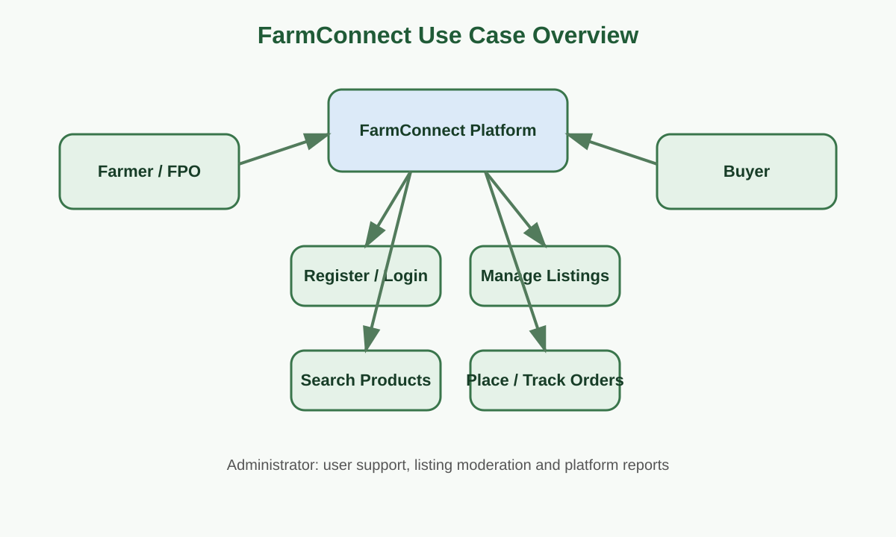
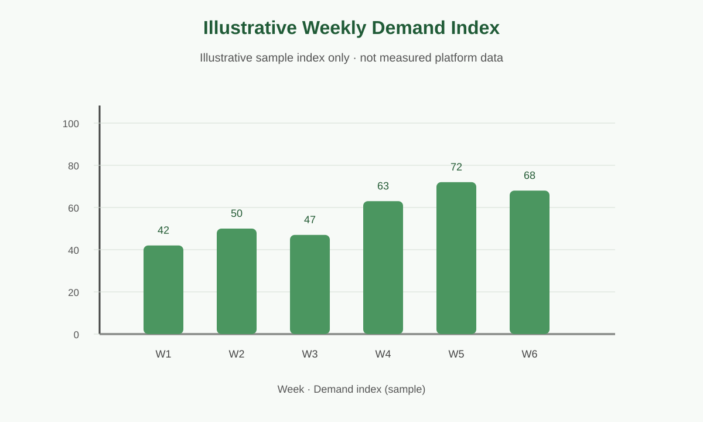
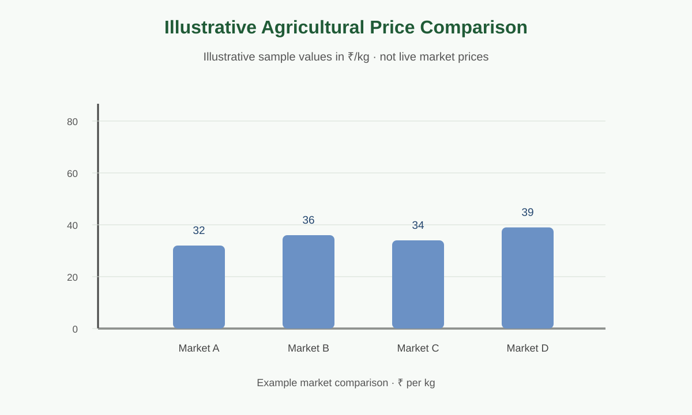

# FarmConnect — Smart Agricultural Marketplace

**Smart India Hackathon | Problem ID: SIH 26033**  
**Theme:** Agriculture, FoodTech & Rural Development  
**Student:** VibeeshKumar  
**Reference number:** 26004488

## Problem statement

Multiple intermediaries in agricultural supply chains can reduce farmers' earnings and increase prices paid by consumers. The proposed solution is a digital marketplace that connects farmers and Farmer Producer Organisations (FPOs) directly with consumers and bulk buyers, while supporting logistics and data-informed demand planning.

## Proposed solution

FarmConnect is a proposed platform for listing agricultural produce, discovering suppliers, managing orders and coordinating delivery.

### Core modules

1. **Farmer registration:** Farmers create accounts and manage their profiles.
2. **Product listing:** Sellers publish produce details, available quantity, price, location and availability.
3. **Buyer connectivity:** Consumers, retailers and wholesalers search and connect with farmers.
4. **Market analysis:** Market information and demand summaries help sellers make informed decisions.
5. **Order management:** Buyers submit orders and sellers update fulfilment status.
6. **Logistics support:** Mapping services can assist with location display and delivery planning.

## Technical approach

| Layer | Proposed technology | Purpose |
|---|---|---|
| Frontend | HTML, CSS, Bootstrap, JavaScript | Responsive user interface |
| Backend | Python, Django | Application logic and APIs |
| Database | SQLite (prototype) | Users, listings and orders |
| Analytics | Python data libraries / ML | Market analysis and demand forecasting |
| Mapping | Mapping service/API | Location and route support |

## Architecture and diagrams

Visual diagrams are embedded below and also available as separate SVG image files. Click an image to open the full-size version.

### System architecture

### Use-case overview

### Order workflow

Source diagrams: [Architecture](docs/diagrams/architecture.md) · [Use cases and DFD](docs/diagrams/use-case-and-dfd.md) · [Workflow details](docs/diagrams/workflows.md)

## Charts and market analysis

### Weekly demand index

### Price comparison

[Market analysis notes and sample-data guidance](docs/charts/market-analysis.md)

**Data note:** Charts and examples are illustrative unless a real dataset and source are explicitly identified. Forecasts must not be presented as actual market outcomes. A production version should record source, market, commodity, unit and observation date for each price.

## Project reports

- [Software Requirements Specification (SRS)](docs/reports/SRS.md)
- [Feasibility study and risk mitigation](docs/reports/feasibility-and-risk.md)
- [Testing plan](docs/reports/testing-plan.md)

A printable project report is also provided separately in this conversation; the Markdown reports above are the version maintained in this repository.

## Feasibility, risks and mitigation

| Risk | Proposed mitigation |
|---|---|
| Limited digital familiarity | Simple mobile-friendly UI, regional-language support and onboarding |
| Poor rural connectivity | Lightweight pages and reduced network requests |
| Outdated stock or prices | Timestamp listings and reconfirm availability before order acceptance |
| Transport constraints | Start with local delivery partners and transparent delivery estimates |
| Forecast uncertainty | Show data sources, date ranges and limitations |

## Expected impact

- **Social:** Better digital participation and direct connections for rural sellers.
- **Economic:** Improved price discovery and fewer avoidable transaction steps.
- **Environmental:** Better supply-demand matching may help reduce spoilage; this must be measured during pilots.

## Suggested evaluation metrics

Track active farmer sellers, listing freshness, buyer-to-order conversion, order fulfilment rate, price transparency and reported unsold/spoiled quantities. Do not claim impact figures until they are measured in a pilot.

## Implementation methodology

1. Design a responsive, accessible website.
2. Build farmer and buyer registration/login.
3. Implement product listing and inventory management.
4. Add buyer search, product details and order workflows.
5. Integrate market information and analytics.
6. Test permissions, workflows, responsiveness and data validation.
7. Pilot with a small group of farmers and buyers; use feedback to improve.

## Research and references

1. [e-NAM](https://www.enam.gov.in/)
2. [AGMARKNET](https://agmarknet.gov.in/)
3. [Digital India](https://www.digitalindia.gov.in/)
4. [Department of Agriculture & Farmers Welfare](https://agriwelfare.gov.in/)
5. [Food and Agriculture Organization (FAO)](https://www.fao.org/)

External datasets and services should be checked for current availability, licensing and attribution before integration.

---
*Project status: proposal and documentation. Features described as planned should not be interpreted as already implemented or tested.*
