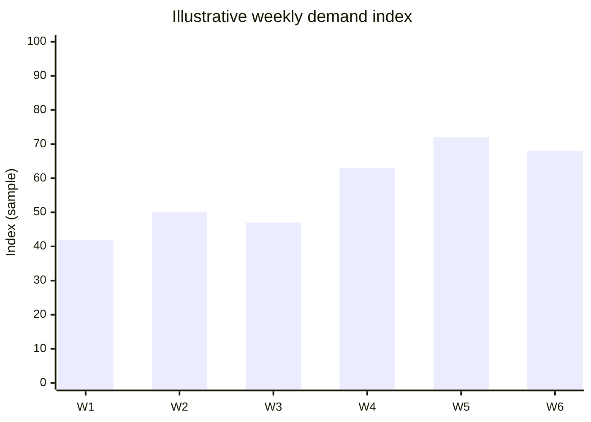
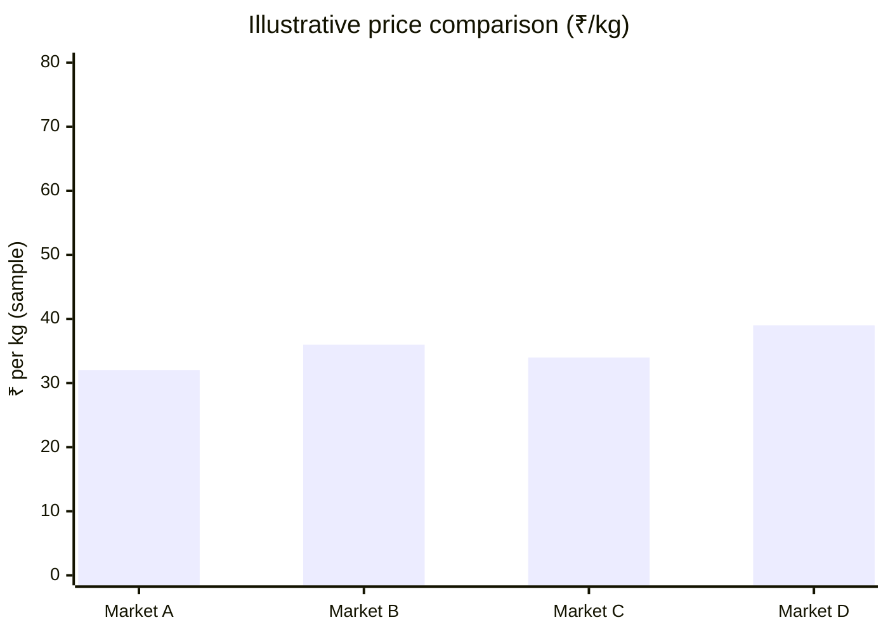

# FarmConnect — Illustrative Charts

The charts below use **sample demonstration values only** to show how the proposed dashboard could visualize information. They are not live AGMARKNET/e-NAM data and must not be presented as measured project results.

## Example weekly demand index

## Example indicative price comparison

## Suggested live dashboard metrics
- Average listed price by crop, unit, location and date.
- Demand index calculated from search and order activity.
- Available quantity and listing freshness.
- Order acceptance, fulfilment and cancellation rates.

Before using real figures, record source, collection date, geography, crop variety, grade and unit. Do not compare unlike products or units.
