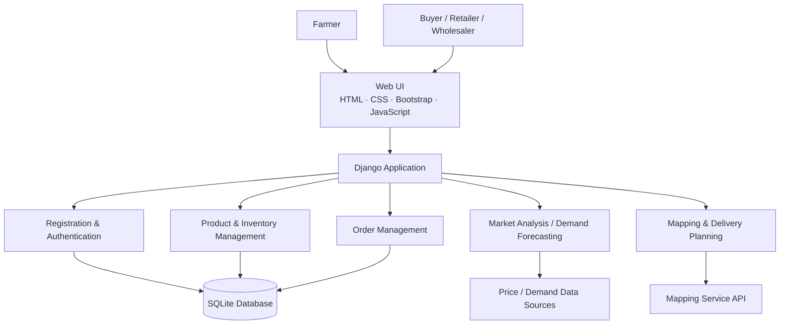

# FarmConnect — System Architecture

## Component responsibilities
- **Web UI:** responsive pages for farmers and buyers.
- **Django:** authentication, validation, business rules and application endpoints.
- **SQLite:** prototype storage for accounts, products, orders and order status.
- **Analytics:** planned analysis of historical prices and demand; predictions require validated data.
- **Mapping:** planned location and route support through an external mapping provider.

> This is the proposed architecture. External data and mapping integrations must be configured before they are operational.
