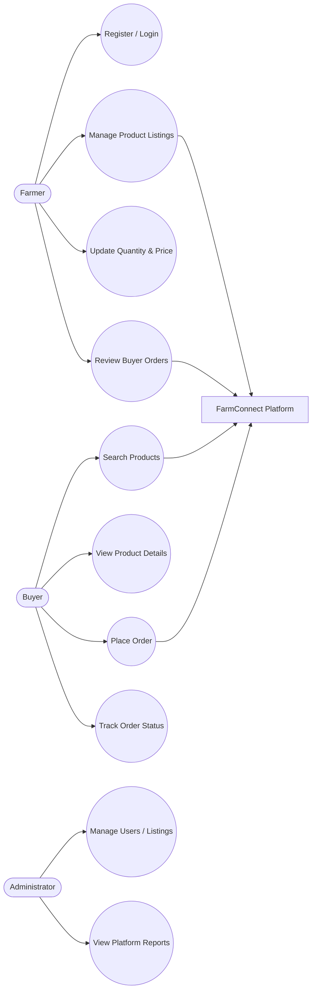
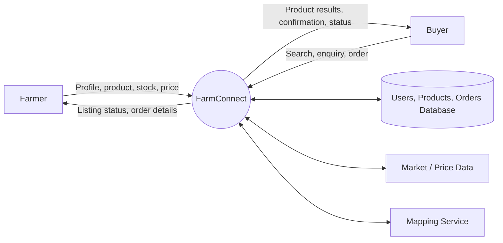

# FarmConnect — Use Case and Data Flow Diagrams

## Use case diagram

## Level 0 data flow diagram

## Main data entities
- **User:** user ID, role, name, contact, location.
- **Product:** product ID, seller ID, name, category, unit, quantity, price, updated time.
- **Order:** order ID, buyer ID, seller ID, items, quantity, total, status, timestamps.
- **Delivery:** delivery ID, order ID, pickup and drop locations, partner, status.

> The diagrams describe the proposed workflow and logical data model, not a verified implementation schema.
